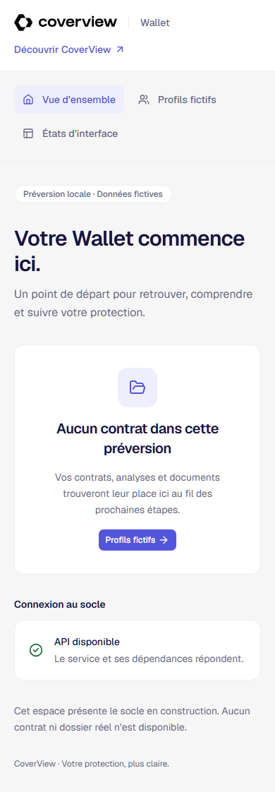

# Livraison S-000a — socle local

Session du 2026-09-05. Autorisation : [mandat séquentiel](../execution-policy.md). État, décisions et journal canoniques : [plan généré](../plans/S-000a.plan.md), depuis `roadmap/state.json`. Cette livraison concerne les quatre coquilles et le socle technique ; les parcours produit restent à leurs slices.

## Ledger

| Statut | Résultat et preuve |
|---|---|
| Vérifié | `pnpm dev` lance API, Wallet, espace équipe et www ; les quatre HTTP répondent en 2xx. Le watch API redémarre après modification. Arrêt du seul arbre lancé et quatre ports libérés. |
| Vérifié | PostgreSQL, Redis, MinIO et Mailpit du compose dédié sont healthy, après démarrage et redémarrage. Migration rejouée et seeds exécutées deux fois : deux personas stables. Testcontainers vérifie aussi une base PostgreSQL vierge, les contraintes et l'idempotence. |
| Vérifié | 26 tests API/contrat-client : configuration, refus fixtures en production, absence de route fixture hors mode local, bornes et erreurs HTTP, dépendances indisponibles, intégrité des personas et parsing des réponses. Démarrage réel avec production/fixture refusé. |
| Vérifié | 47 tests d'outillage : cycle preview, ports étrangers, PID périmé, échecs infra/process/probe, bundles avec faux secrets, roadmap et garde. Aucun test désactivé pour obtenir ce résultat. |
| Vérifié | Cinq parcours Playwright : liens www vers Wallet, clavier/skip-link, pages vides, deux personas persistées, introuvable, erreur réseau injectée puis reprise, petit écran sans débordement. Captures ci-dessous inspectées visuellement. |
| Vérifié | Panne réelle Redis provoquée sur le seul compose CoverView : liveness 200, readiness 503, erreur visible dans Wallet ; Redis rétabli puis bouton Réessayer rend API disponible. |
| Vérifié | Deux cycles réels start/start/status/stop de la preview : second start conserve exactement les PID, statut 2xx, stop libère les quatre ports. |
| Vérifié | Frontières : canari frontend→API/DB, import `node:fs` et dépendance de développement refusés ; canari retiré puis vérification nominale réussie. Recherche de secrets sur les neuf fichiers de bundles réussie ; canaris PostgreSQL/Redis/Redis TLS refusés sans imprimer leur valeur. |
| Vérifié | Contrôle marque : 46 tokens, 18 contrastes, six sources intactes. Les SVG et tokens fournis conservent les octets Git d'origine ; `.gitattributes` stabilise les fins de ligne sous Windows. |
| Fait non vérifié | Reproduction complète de la recette CI depuis un nouveau checkout : en cours au commit d'implémentation ; résultat et SHA seront ajoutés avant clôture. |
| Fait non vérifié | Workflow GitHub Actions écrit ; aucun push ni job distant exécuté. `db:reset` possède une garde et sa destruction est documentée ; la commande destructive n'a pas été exécutée. Aucun déploiement, compte WorkOS ou email externe testé dans cette slice. |
| Supposé | Français initial et ports locaux sont des choix réversibles. Si inadaptés, modifier catalogues i18n ou configuration locale ; aucune règle métier ni habilitation n'en dépend. |

## Ce que manipule réellement la preview

La seule table créée est `local_preview_personas`, avec identifiants fictifs, adresses `.test`, libellés d'espaces et horodatages techniques. Le sélecteur change l'affichage local ; il ne crée ni identité WorkOS, ni session, ni droit administrateur, ni foyer. Les états de démonstration sont étiquetés. Aucun événement métier, room, job, paiement ou notification externe n'est produit. Les services S3 et email sont seulement contrôlés en santé ; aucune intégration métier n'est revendiquée.

Les variables requises et les garde-fous vivent dans [platform](../../apps/api/src/platform/README.md) et [`.env.example`](../../.env.example). Les valeurs de cet exemple sont exclusivement locales et fictives. Les interfaces n'embarquent pas les credentials serveur. Les routes de preview sont limitées au développement, le serveur refuse les fixtures hors local/development et les adresses distantes dans ce mode.

## Dépendances et adaptations

[Inventaire exact et provenance npm](S-000a-dependencies.json) : 49 dépendances directes distinctes ; le lockfile reste la référence exécutable. Chaque famille satisfait un besoin du socle imposé : Fastify/Zod et protections HTTP, Drizzle/Postgres et Redis, React/TanStack/i18next, Astro/MDX, Tailwind/shadcn, Vitest/Testcontainers/Playwright, TypeScript et chaîne de qualité. Les outils de build et la stdlib sont réutilisés ; aucun deuxième framework ni module métier anticipé.

Les registres et documentations officiels ont été consultés avant sélection. Exception de compatibilité explicitée : TypeScript reste à la dernière stable acceptée par le peer range de typescript-eslint, sans remplacer ni désactiver l'outil imposé. Les types Node suivent la LTS exécutée. Le preset imposé a été appliqué par la CLI officielle dans deux projets de préparation : [provenance UI](../../packages/ui/README.md). La police Geist conserve OFL-1.1, hors allowlist de code et explicitement apportée par ce preset. Les images sont fixées à leur digest téléchargé, MinIO étant le service local imposé.

Un audit initial a signalé esbuild transitif de drizzle-kit. Un override limité à son parent le remplace ; génération Drizzle, migrations et tests ont été rejoués. L'audit final ne signale aucune vulnérabilité connue. Les scripts d'installation sont autorisés nominativement ; les accélérateurs SSH optionnels et le message postinstall protobufjs sont refusés car sans besoin local. Les exceptions d'âge de publication concernent uniquement la version stable Playwright installée.

Adaptations du scaffold livré : configurations transformées en modules ESM et espaces CoverView ; types/lint adaptés aux fichiers TSX/MDX/Astro réels, frontière Node détectée par le type `core`, points d'entrée knip explicites. Deux imports inutilisés du harness ont été retirés pour le lint global. Aucun contrôle n'a été désactivé ; `dependency-cruiser` conserve un avertissement de fichier orphelin pour un catalogue importé par Astro, dont il ne parse pas les imports. Knip ne signale aucun inutilisé.

Licences des services imposés : [PostgreSQL](https://www.postgresql.org/about/licence/) est permissive, [Mailpit](https://github.com/axllent/mailpit) MIT ; [Redis serveur](https://redis.io/legal/licenses/) propose RSALv2, SSPLv1 ou AGPLv3, distinct du client npm MIT. [MinIO](https://github.com/minio/minio) est AGPL-3.0 ; son dépôt est archivé depuis avril 2026 et les anciens binaires ne reçoivent plus de mises à jour. Son image est utilisée exclusivement comme dépendance locale imposée, sans la présenter comme maintenue. Le remplacement éventuel de cette partie de la stack relève d'une décision explicite. L'audit npm ne constitue pas un scan des images ni une analyse exhaustive de leurs licences transitives.

## Limites et revue

Le build Vite avertit sur la taille des coquilles applicatives ; mesure et optimisation produit suivront leur slice propriétaire. Le site est une préversion avec noindex et métadonnées explicitement provisoires. Les gros ajouts du bootstrap dépassent le DEVRAIT de petite PR : ils composent une seule initialisation de la stack imposée, sans refactoring métier. Aucun changement d'instance Infomaniak ni de service Docker étranger.

Une première preview réelle a échoué car Astro s'auto-détachait dans le contexte agent. Après diagnostic du processus réellement créé, son arrêt officiel puis un wrapper qui conserve la supervision unique ont permis les deux cycles. L'association Turbo/tsx watch sous Windows bloquait aussi l'API ; le watcher natif Node avec chargeur tsx a passé démarrage et rechargement. La revue indépendante a fait corriger les codes HTTP 400/413, le filtre des sources de frontières et la détection Redis TLS avant clôture. Aucun mécanisme interne de panne n'est affirmé au-delà des reproductions observées.

## Captures du parcours observé

Rejouer : procédure dans le [README](../../README.md), preview démarrée puis `pnpm test:e2e`. La session demandée et transmise est gpt-6-astra / ultra ; le modèle hôte est GPT-6, l'effort effectif n'est pas observable indépendamment du paramètre transmis. Coût et taux de contexte non disponibles.
